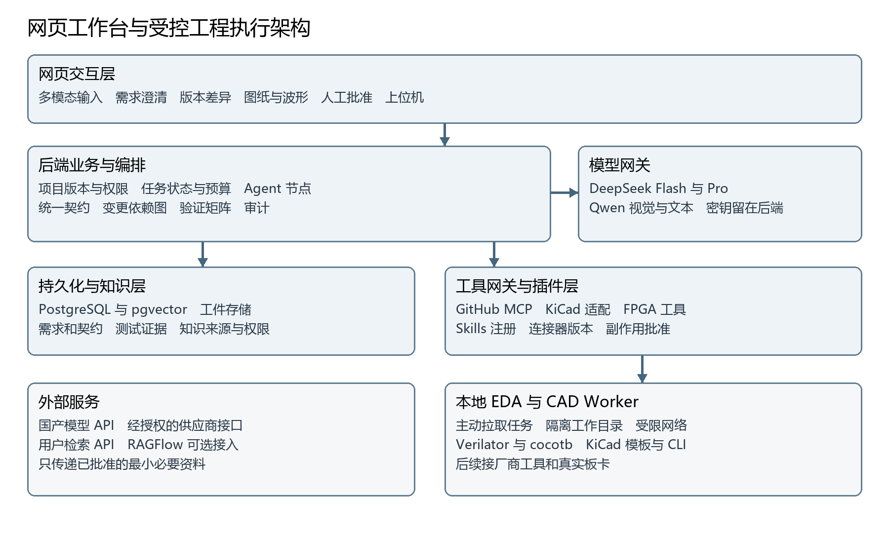
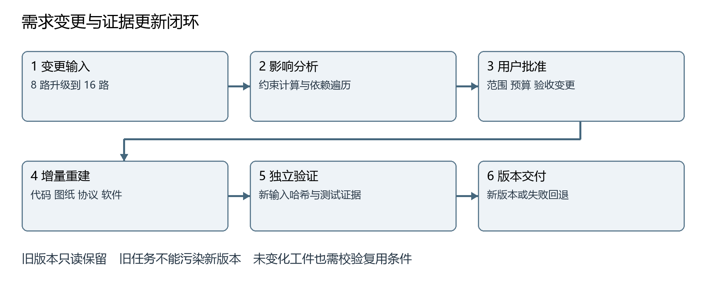

# FPGA 多 Agent 协同开发平台完整设计方案

面向需求变更的可验证软硬件协同开发

版本 1.0　设计日期 2026 年 10 月 29 日　适用团队 三人参赛团队（两人编码）

## 阅读说明

本方案整合此前需求讨论、原始编程模板审查和本轮确认，用于拆分开发任务与验收。项目交付物是一个网页工程工作台，生成的 FPGA 工程、采集扩展板图纸和产品上位机是该工作台的工程产出，两者不能混淆。

结论是方案可行，但必须把自动生成、工具验证和人工工程审核分开。首版聚焦一个真实案例，贯通需求澄清、契约、图纸、RTL、仿真、上位机和版本交付；不以“多角色聊天”代替工程结果，不声称仿真通过就已完成产品量产。

本文件是设计基线草案，不是已经实现或通过测试的声明。本轮未安装插件、授权账号、调用付费模型、执行 EDA、推送代码或更改现有源码。具体工具版本、账号权限与支出上限仍须在实施前登记。现按用户最新确认：本机运行、国内报价优先并与一个海外来源比较、首版完整实现各类管理与扩展能力。

建议阅读顺序：队长先读第 1 至 4 章和第 22 至 24 章；平台开发者重点读第 5 至 9 章、第 15 至 19 章；硬件与验证开发者重点读第 10 至 14 章和第 20 至 21 章。

## 1 已确认的决策和现有基础

### 1.1 本轮确认

| 决策 | 状态 | 设计结论 |
|---|---|---|
| 团队与模型限制 | 已确认 | 三人团队、两人编码；允许国产模型 API，优先 DeepSeek 与 Qwen |
| 主架构 | 已确认 | 网页工作台加后端编排加本地 EDA Worker |
| 首版验证方式 | 已确认 | 仿真优先，实板在后续阶段接入 |
| 演示产品 | 已确认 | 可配置数字信号采集与协议分析仪，展示 8 通道升级到 16 通道 |
| 编程模型 | 已确认 | 以 DeepSeek V4.1 Flash 替换此前 GLM 方案 |
| 知识库路线 | 已确认 | 轻量内置知识库起步，首版支持外部检索 API 接入；RAGFlow 可选、不强制部署 |
| KiCad 范围 | 已确认 | 首版必须接入；先生成未绑定板卡的参考图纸及源文件、BOM、网络表和 ERC；资料齐全后再绑定和电气审核 |
| PCB 和主板 | 已确认 | 保留完整路线，不在首版承诺全自动 FPGA 主板或可直接投产 |
| 管理与生态范围 | 已确认 | 模型、MCP、RAG、Skills 和插件管理与扩展机制首版完整实现，不缩成最小管理版 |
| 部署与资源 | 已确认 | 当前仅在用户本机测试开发运行；已提供两台 3090、Windows、32 GB 内存的信息，但不假定双机同时可用 |
| 数据与时间 | 已确认 | 首版使用免费可合法获取资料；提交截止 11 月 10 日 |
| 报价策略 | 已确认 | 国内多个来源优先，与一个海外来源做同口径对照 |
| 其他接入权限 | 待确认 | API 预算、供应商授权、GitHub 认证、本机隔离环境与电气模板审核人 |

### 1.2 现有模板复用边界

本地 `fpga-agent-development-master.zip` 的源码已在前序审查中确认适合复用为 RTL 生成与受限修复内核，不具备本方案描述的完整平台。已有候选提取、端口检查、部分编译综合封装、预算和证据记录；缺少前端、通用项目编排、需求契约、知识库、图纸、报价和产品级上位机。

原链路绑定本地模型、loopback HTTP、vLLM 分词、精确 usage、GPU 准入和固定器件，不能仅换模型名称和 URL。新建显式 API Provider 和 Coding Runner，旧链路与冻结 Skill 保留为对照。此前 26 项部署测试是 23 项通过、3 项失败；没有进行真实 API、Vivado 或实板验证。更早审查报告中的非国产模型建议已被本设计替代，不继续作为实施依据。

前序已将原始快照及说明导入用户指定私有仓库。该事实不代表本轮已经同步新设计，也不代表仓库当前远端没有他人更新。实施前须重新获取远端状态，使用功能分支和 PR。

### 1.3 三种架构的取舍

| 路线 | 优点 | 主要代价 | 结论 |
|---|---|---|---|
| 纯桌面应用 | 直接访问串口、文件和 EDA | 评委需安装；跨机器部署与协作困难 | 保留为后续本地封装 |
| 全云端服务 | 集中部署，网页直接使用 | EDA 许可、算力与硬件连接要求高 | 非首版主线 |
| 网页加后端加本地 Worker | 方便展示，复用现有工具，支持云边协作 | 需要任务持久化和 Worker 安全边界 | 用户已选定 |

## 2 项目定位和比赛策略

### 2.1 用户和问题

首批用户是教学实验室和小型硬件研发团队。典型困难不是“写不出一段 Verilog”，而是需求参数不清、软件与硬件协议不一致、变更导致多个文件失配、验证结果难复现，以及图纸和报价缺乏来源。

拟用项目名称为“面向需求变更的可验证 FPGA 软硬件协同开发平台”。这仍是建议名称；如果已报名，应保留已登记题目，避免自行改变比赛主题。平台目标是减少重复录入和跨模块协调成本，让工程师掌握批准权和可信证据，而不是替代所有硬件工程审核。

### 2.2 三个主攻亮点

| 主攻亮点 | 实现机制 | 现场可见证据 |
|---|---|---|
| 统一软硬件接口契约 | 结构化规格共同驱动 RTL 接口、协议解析、上位机参数、网络连接和测试清单 | 修改一处通道数，多类工件受控更新；故意使用旧协议被拒绝 |
| 需求变更影响分析与增量重建 | 版本化需求和工件依赖图，确定失效范围，按拓扑重建，保留回滚 | 8 到 16 通道的影响列表、差异、重跑任务和旧版本回放 |
| 独立验证驱动的故障修复 | 公开开发测试反馈给 Agent，独立验收测试保持隔离；工具证据决定状态 | 注入错误、捕获失败、有限修复和再次验证，不用模型自评作结论 |

这三个能力必须共同工作。只有契约没有验证，会得到“一致但错误”的工程；只有验证没有变更管理，改需求后旧结果容易被误用；只有多 Agent，没有明确工件和权限，容易出现互相覆盖和无界讨论。

### 2.3 其他加分项全部纳入规划

P0 为完整首版验收项，P1 为工程增强，P2 为制造产品化路线。依用户要求，全部模型、MCP、RAG、Skills 和插件管理及可扩展生态能力均属于 P0，具体完成定义见第 17.4 和 22.4 节，不再缩减为最小管理版。完整首版与 11 月 10 日比赛提交节点分开记录；范围承诺不等于工期保证。

| 加分项 | 阶段 | 展示和价值 |
|---|---|---|
| 需求澄清和单位冲突检查 | P0 | 识别高速采集与低速实时上传的矛盾，要求用户选择模式 |
| 多模态输入与引用定位 | P0 | 文本、PDF、Word、表格和图片进入需求流；点击证据回到页码或单元格 |
| 可编辑 KiCad 图纸闭环 | P0 | 审核模板生成 8／16 通道原理图，网络表比对、ERC 和导出 |
| 工程证据档案 | P0 | 需求、模型、Skill、代码、工具链、测试和图纸哈希可追溯 |
| 可配置模型及国产限定 | P0 | 每个 Agent 选择已批准模型配置，运行途中不被静默换配置 |
| Skills 与插件管理 | P0 | 完整生命周期、可添加来源与自定义包、依赖与权限审批、SDK、升级回滚和审计 |
| GitHub 协作闭环 | P0 | 差异预览、经批准推送分支和 PR、检查结果，禁止默认自动合并 |
| 虚拟设备与历史回放 | P0 | 上位机操作可连接真实 RTL 仿真适配器；历史结果显式标记回放 |
| 可追溯报价 | P0 | 国内多源与一个海外源对照、接口及导入模式、阶梯价、期限和差价解释 |
| 成本性能多方案比较 | P1 | 先排除电气不可行方案，再展示价格、资源、交期的非劣方案 |
| 故障案例库 | P1 | 将审核后的根因、修复和适用版本入库，避免未经审核的自学习 |
| 双板复用和硬件在环 | P1 | 相同逻辑通过两个板卡描述文件构建，真实测试后才能展示 |
| 国产器件适配 | P1 | 用户板卡或候选器件支持时增加厂商适配，不假定必须换板 |
| 完整 PCB 和制造交付 | P2 | DRC、封装核验、制造文件、打样和实测逐级批准 |
| 可扩展生态与本机部署 | P0 | 自定义来源目录、包完整性与信任策略、兼容测试、外部知识 API 及工具可添加 |

### 2.4 往届作品和评分启示

“零件专家”获奖报道介绍了领域知识、RAG、CAD 和制造流程结合的方向；本项目应借鉴工程工件和专业数据闭环，而非复制其模型组合或宣传性效果数字。[来源 S01]

北理工“电子器件组成分析与报价助手”报道涉及器件数据、性能和价格辅助设计，但未公开完整源码或报价算法。本方案的报价算法是自己的工程设计，不冒称复现了其内部实现。[来源 S02]

2025 年湖北科技学院培训材料提到数据 15、分析 35、解释与建议 15、创新 10、Agent 成果 25 的参考分项。这不是已确认的 2026 全国赛最终权重。新一届公开高校通知强调真实场景、应用价值和可验证交互；因此本方案以独立测试、图纸、变更链和可访问演示来证明价值，不以 Agent 数量推算获奖概率。[来源 S03、S04]

## 3 首个演示产品和验收规格

### 3.1 产品定义

产品为“可配置数字信号采集与协议分析仪”。FPGA 执行同步采样、触发、缓存、分包和串行传输；上位机进行参数设置、波形显示、数据保存及协议分析。首版协议分析先支持离线 UART 8N1 解码，SPI 和 I²C 作为扩展，避免同时引入过多验证对象。

下面是设计默认值，而非用户已逐项确认的实板指标。它们用于仿真场景，可以在需求确认页修改；开发板型号、电压、引脚和时钟来源未确认时，禁止把虚拟板参数用于烧录。

| 参数 | 首版建议值 | 升级演示及边界 |
|---|---|---|
| 通道数 | 8 路数字输入 | 变更为 16 路，重建受影响工件 |
| 仿真系统时钟 | 100 MHz | 实板由 board_profile 提供，不能直接继承 |
| 采样率 | 1 MHz 和 10 MHz 两档 | 先使用时钟使能，不创建未经约束的派生时钟 |
| 采样深度 | 每通道同步采样 4096 个时刻 | 8 路为 4096 字节，16 路为 8192 字节 |
| 触发方式 | 软件触发、选定通道上升沿触发 | 首版采集触发后的 4096 个样本；预触发缓存列为 P1 |
| 上传模式 | 有限次突发采集后上传 | 不承诺以 UART 连续实时上传全部原始采样 |
| 控制链路 | UART 115200 波特，8N1 | 仿真验证分包；实板需确认 USB 转串口能力 |
| 输入电气 | 仿真逻辑信号 | 实物端电压、容限、保护与电平转换必须补证 |
| 输出 | 波形、采样元数据、CSV 和二进制文件 | 统一时间单位、字节序、通道顺序和契约版本 |
| 图纸 | 8／16 通道采集扩展板参考原理图 | 标注假设和未绑定接口，不可直接接线，不是完整 FPGA 主板 |

### 3.2 必须展示的可行性计算

8 路、10 MHz 的原始数据速率为 80 Mbit/s；16 路为 160 Mbit/s。UART 115200 波特在 8N1 下的理想有效载荷上限是 11520 字节每秒，即 92.16 kbit/s，尚未扣除应用协议开销。系统必须指出实时连续上传不可行，而不是默默生成一个看似可用的串口方案。

4096 个样本在 10 MHz 下覆盖 409.6 微秒。8 路数据经上述 UART 上传至少约 0.356 秒，16 路至少约 0.711 秒，实际还受帧头、CRC、握手与重传影响。建议采用“先采集、再上传”；若用户坚持实时连续数据，重新评估高速链路、缓存和成本，不承诺压缩必定降低数据率。

这些计算由单位感知的确定性函数完成，Agent 只解释结论。跨时钟、异步输入同步和亚稳态不能靠 RTL 仿真消除；数字采样仪也不能被宣传为测量模拟信号质量或精确重建任意窄脉冲的仪器。

### 3.3 首版独立验收

至少覆盖采样顺序、深度边界、触发边界、复位中断、串口分包、CRC 错误、丢帧、重复命令、超时、非法通道数、8／16 位打包和上位机解码。构造已知 UART 8N1 波形，核对解码字节、时间位置和错误标记。

同一输入必须经独立 Python 参考模型得到预期值，不能仅把由同一契约生成的发送器与接收器互相对拍。故障注入建议选择计数终点偏一、通道打包字节序错误、CRC 覆盖范围错误三类，冻结注入补丁与期望失败；修复后必须重跑独立测试。

## 4 全生命周期工作流和人工批准

### 4.1 工作流

用户材料 → 文件解析 → 需求澄清 → 需求基线 → 系统设计 → 软硬件契约 → 选型及报价 → 原理图与 RTL 及上位机开发 → 独立验证 → 故障修复 → 工程交付 → 实板验证 → 打样和量产。

这是存在并行和回路的依赖图，而非一次性流水线。契约确认后，RTL、上位机和图纸可以并行；选型变化可能返回系统设计；验证失败返回对应实现节点；需求变更创建新版本，不直接覆盖旧版本。首版在“可复现仿真工程交付”处验收，后续制造阶段保留接口与审核清单。

### 4.2 阶段产物和准入

| 阶段 | 必须产生的工件 | 进入下一阶段的条件 |
|---|---|---|
| 需求 | 原始需求、澄清记录、参数表、验收条目 | 关键未知项解决，用户批准基线 |
| 架构 | 模块图、数据率和缓存计算、时钟复位策略、风险表 | 确定性约束检查通过，工程师审核 |
| 契约 | 接口、协议、寄存器、错误码、采样语义 | Schema 和语义检查通过，版本冻结 |
| 选型和报价 | 候选、证据、BOM、报价快照 | 硬约束匹配；缺失字段不伪装成满足 |
| 原理图 | KiCad 源文件、网络表、BOM、ERC、导出图 | 可打开；关键网络与契约一致；例外有审核 |
| 实现 | 多文件 RTL、上位机、工具配置和构建说明 | 静态检查和公开开发测试通过 |
| 独立验证 | 测试报告、日志、波形、环境及哈希 | 该版本要求的全部验收项通过 |
| 交付 | 差异、PR、工程包、使用说明、已知限制 | 人工批准，不能存在被旧证据冒用的工件 |
| 实物和制造 | 引脚审核、实测、PCB、制造与生产测试资料 | 分阶段人工签核，首版不宣称完成 |

模型不得自行批准自己的需求、设计例外或测试豁免。用户可暂停、补充需求、拒绝方案或回退版本，平台必须保存原因和批准人。

## 5 总体软件架构

### 5.1 分层和边界

采用模块化单体后端加独立 Worker，不让每个 Agent 都成为微服务。角色是配置和受控流程节点，不等于十几套部署服务。



前端只处理交互、上传、查看和批准，不持有模型或供应商密钥。后端维护项目事实、权限、工作流、模型调用和审计。Worker 主动拉取授权任务，运行 EDA 或 CAD 并返回证据；不要求评委电脑装 EDA，也不向公网开放一个任意命令执行端口。

### 5.2 推荐技术组成

| 层 | 首版建议 | 选择理由及限制 |
|---|---|---|
| 网页前端 | React、TypeScript、Vite | 工作台和产品上位机共享基础组件，不共享权限 |
| 后端 | Python、FastAPI、Pydantic | 复用现有 Python 内核，明确 Schema 和接口校验 |
| 编排 | LangGraph 的状态图和检查点能力 | 适合人工等待和有状态流程；业务事实仍以项目数据库为准 |
| 数据 | PostgreSQL 加 pgvector | 项目、任务、权限和轻量向量检索共用一个数据库实例 |
| 工件 | 受控文件目录加哈希索引 | 首版减部署负担；预留 S3 兼容对象存储适配器 |
| 任务调度 | PostgreSQL 持久化任务表和独立调度进程 | 三人原型无需先部署 Redis、Kafka 或 Kubernetes |
| 仿真 | 受控 Linux 环境中的 Verilator 加 cocotb | 固定工具版本和小范围 SystemVerilog 子集；工具支持需烟测 |
| 厂商工具 | 后续按实际板卡接 Vivado 或对应厂商工具 | 不把某厂商工具当成所有 FPGA 通用工具 |
| CAD | 固定版本 KiCad 与受控适配器 | 审核模板、CLI 校验和导出；第三方 MCP 先做兼容试验 |

LangGraph 官方定位支持有状态编排、人工介入和流式输出；它并不自动解决本项目的业务事务与安全隔离。[来源 S05] pgvector 是 PostgreSQL 的向量检索扩展，不是完整知识库服务。[来源 S06]

### 5.3 部署和任务恢复

用户最新要求是本机开发和运行：浏览器、前端、API、PostgreSQL、调度器、工件目录与 Worker 首期都部署在用户电脑，服务默认只绑定回环地址；不创建云服务器、不默认开放公网端口、不假定第二台 3090 正在参与任务。模块间仍通过稳定接口通信，以便将来拆到其他机器。

本机启动器负责环境检测、迁移、按序启动、健康检查、日志和受控停止；提供备份及恢复演练。Windows 上 KiCad 可原生运行。仿真优先验证隔离 Linux Worker 路线，但 WSL2／虚拟机能否使用尚未确认；若只能原生 Windows，先验证对应工具组合再发布支持矩阵，不能把 PATH 不同当作唯一迁移成本。没有可用隔离环境时不得执行模型生成的任意脚本。

两台 3090 与 32 GB 是用户提供的资源信息，内存是单机还是合计、当前本机具体配置仍需检测。主模型使用 API，不要求本地加载大模型；3090 可用于以后本地向量或 OCR，不纳入本轮必需依赖。优先实测 CPU、磁盘、仿真及 KiCad 内存峰值，不把 GPU 显存当作系统 RAM。

参赛交付另设分发方案：本机启动包、录屏与工程包可先准备；若本届最终要求远程访问，则需在授权后安排托管或受控远程演示。localhost 不是评委可访问网址，也不能只凭网页界面推断比赛接受本机形式。

任务包含 job_id、project_id、revision_id、input_hash、tool_profile_id、attempt 和截止时间。Worker 领取带租约和递增 fencing token 的任务；建议心跳 15 秒、租约 60 秒，实际值经长任务测试调整。旧租约结果不得覆盖新 attempt；Worker 断线显示 UNKNOWN 或待重试，不误报通过。

Graph 检查点不是“外部操作恰好执行一次”的保证。数据库提交任务与 outbox 事件使用同一事务；副作用工具用 invocation_id 和唯一约束去重。仿真可基于相同输入重新运行，推送 PR 需先查是否已有，烧录或采购不得自动重试。恢复时先对账，再推进状态。

首版默认每个 EDA Worker 同时执行一个重任务，模型调用全局并发两个，防止三人同时触发导致机器或预算耗尽。取消请求停止后续节点，终止隔离任务的进程树并保留已有日志；“已取消”不表示服务商一定未计费。

## 6 Agent 角色和协作契约

### 6.1 角色目录

| 角色 | 输入和输出 | 默认模型与权限 |
|---|---|---|
| 需求澄清 Agent | 多模态材料到参数、问题、验收条目 | Qwen Plus；只读知识与项目 |
| 系统设计 Agent | 需求到模块、时钟复位、数据流、候选方案 | Qwen Plus；复杂复核可请求 DeepSeek Pro |
| 选型和报价 Agent | 约束到候选 BOM、报价及来源 | Flash 组织与解释；参数查询和金额由工具完成 |
| 原理图 Agent | 审核契约到模板实例、网络连接和变更 | Flash；受控 KiCad 工具，不任意编辑主机文件 |
| RTL 编程 Agent | 模块规格到 RTL 和公开开发测试 | Flash；只能写当前候选目录 |
| 上位机 Agent | 协议和 UX 规格到软件、解码器和测试 | Flash；不能改变未经批准的硬件协议 |
| 验证 Agent | 验收规格到测试计划和测试任务 | Flash 生成公开测试建议，独立验收由受保护测试执行 |
| 故障诊断 Agent | 可公开日志和波形摘要到根因及最小补丁 | Flash；难例经预算批准升级 Pro |
| 变更分析 Agent | 新需求与基线差异到影响建议 | Qwen Plus；依赖遍历和失效判定由程序执行 |
| 交付 Agent | 已有工件和证据到说明与报告 | Qwen Plus；不能把未验证状态改写为通过 |
| 审核角色 | 方案或代码的独立意见 | 可选 Pro；其意见不是验证结论 |

任务协调器是状态机和调度器，不必再为其单独配置一个“总指挥大模型”。以上角色可以共享模型和服务，但不能共享无限上下文、无边界文件权限或未经版本化的可变状态。

### 6.2 节点交接结构

每次交接使用 TaskEnvelope，至少包含任务目标、需求与契约版本、允许输入工件、允许工具、写入范围、输出 Schema、验收条件、时间和费用预算、需要的批准。输出为结构化工件和问题列表，不是只有一段自然语言。

上下文由 Context Builder 按角色组装：批准的需求和契约优先，再取必要的源文件、Skill、已授权检索片段和工具诊断。对话摘要只是辅助，不取代项目事实。不要将全体聊天、所有 PDF、所有 MCP 工具描述一次性塞给每个 Agent。

冲突按“已批准契约优先、冲突项升级人工、不得静默猜测”处理。并行节点使用独立工作目录和候选分支；写同一个文件时串行合并或要求重新基于最新版本生成，不采用最后写入覆盖。

## 7 国产模型底座与 API 配置

### 7.1 默认模型池

| 用途 | 展示名称 | 服务端模型标识或接入要求 |
|---|---|---|
| RTL、代码、图纸脚本和修复 | DeepSeek V4.1 Flash | 官方直连当前用 deepseek-flash，对应 V4.1 Flash 1017 |
| 需求、多模态理解和文档 | Qwen 3.7 Plus | qwen3.7-plus，按百炼区域和账号确认 |
| 高难诊断与复核 | DeepSeek V4 Pro | deepseek-v4-pro，非每个节点默认使用 |
| 文本向量 | 百炼文本向量模型 | 首版候选 text-embedding-v4，固定模型及维度 |
| 检索重排序 | Qwen Rerank | 首版候选 qwen3-rerank，候选片段重排 |

DeepSeek 官方文档核实了 `deepseek-flash` 的当前映射；模型展示名、API ID、服务商和实际返回模型字段分别保存。同名模型经不同供应商调用，参数、配额和价格可能不同，不能混用标识。阿里云文档列出 Qwen Plus 的文本及视觉理解与向量重排选项；具体账号可用性尚未实测。[来源 S07、S08、S09]

本方案不再使用 GLM 作为默认模型。默认图片通道交给已配置视觉能力的 Qwen，Flash 接收结构化抽取结果；以后如果验证其他 Provider 的视觉接口，可在能力矩阵中启用，不依据模型家族名称猜测支持情况。模型厂商定位不能证明 FPGA 任务优劣，最终仍按本项目独立测试选择。

### 7.2 可配置模型中心

管理员维护 Provider、允许的 HTTPS 端点、凭证引用、协议适配、模型列表、能力、单价版本和预算。每个 Agent 卡片引用 ModelProfile，可选择文本或视觉能力、输出上限、超时、重试及允许的备用模型。开发者选择已有配置，评委只能用预设配置。

模型配置必须通过能力探测和契约测试，至少检查结构化结果、工具调用、流式中断、空输出、截断、拒绝、usage 缺失和限流。参数不被服务商支持时明确报错或使用已审核适配，不在接口层无声删除。不能将“兼容某 API 格式”理解成全部字段和计费一致。

主调用协议优先采用 DeepSeek 官方 Chat Completions 文本接口，避免对原模板同时引入不必要的协议变更。`/tokenize` 不可伪造；新 Provider 区分 exact、estimated、unavailable 的预估计数，实际费用依据真实 usage 和价格版本。未知消耗保留 unknown，不记成零。配置改变只对新任务生效；当前运行保存不可变快照。

### 7.3 凭证和数据策略

Key 只存后端密钥设施或受保护环境配置，不放浏览器、Prompt、普通日志或 Git。默认只允许国产模型白名单；自定义接入不默认放开非国产备用路由。用户已允许国产外部 API，并要求首版只使用免费资料；只接入可合法获取且允许本用途的公开资料，私有文档外发仍需另行批准。本机运行不等于不外发，免费阅读也不等于可批量复制、重分发或训练。

费用采用预留加结算，单位使用 Decimal。重试共享同一任务截止时间和预算；默认最大修复三轮，HTTP 暂态故障有限退避。API Key、预算和部署区域未确认前，只能做无外网的契约测试，不能以 mock 成功宣称真实模型接入完成。

## 8 需求澄清和多模态输入

### 8.1 需求 Agent 的职责

将“提示词优化 Agent”命名为“需求澄清与任务规格 Agent”。它不只润色表达，而要提取功能、性能、接口、供电、环境、预算、交期和验收方法，并为每项标记“用户明确”“证据推导”“建议默认”“未知”及来源。

问题队列优先处理会改变架构的参数：连续或突发、采样率、通道数、数据链路、现有板卡和电压。次要命名或 UI 配色可使用公开默认值。每轮建议提出一至三个相互关联的问题；完成度只作导航，不能用一个百分比分数绕过未解决的关键项。

用户提交答案后由字段校验器检查单位、范围和冲突，再更新问题队列。等待用户时持久化状态，用户回复触发恢复，不让 Agent 在后台无限轮询消耗 token。需求冻结需要用户确认；后续补充作为 ChangeRequest，不悄悄改写已批准基线。

### 8.2 输入框和文件处理

输入框支持文本、粘贴或拖放附件、附件预览、选择 Agent、手动选择或推荐 Skills、引用项目工件。支持“本次任务使用”与“审核后加入项目知识库”两种范围，上传不等于永久入库。

| 类型 | 首版处理 | 不能省略的检查 |
|---|---|---|
| PDF、DOCX、MD、TXT | 提取段落、表格、标题与页码或位置 | 原文哈希、编码、解析失败提示 |
| PNG、JPEG | OCR 和视觉理解，保留图片及框选来源 | 数字、引脚、电压和小数点人工复核 |
| CSV、XLSX | 按行列读取，保留表头、单位、公式或缓存状态 | 不运行宏；公式缓存缺失不能当真实计算值 |
| RTL、约束、日志 | 纯文本和语言解析 | 不自动执行上传的 Tcl、Python、Shell |
| KiCad 原生工程 | 独立 CAD 适配器读取 | 工程版本、库依赖、路径和网络表 |
| ZIP | 有限解包与文件清单 | 路径穿越、符号链接、膨胀比、大小和文件数 |

建议初始限额为每次 10 个附件、单文件 25 MB、单任务 100 MB、PDF 200 页，均为可配置工程默认值。大型波形通过专用工件通道上传，不挤进聊天附件。MIME、扩展名和内容类型交叉检查；解析进程隔离、无网络、有限 CPU 和内存，文件内容视为不可信数据。[安全依据 S10]

### 8.3 文本和图片到工程事实

先提取可检索文本，再按需要将选定页面或图片发送视觉模型，不把整本手册重复发送给每个角色。扫描 PDF 的 OCR 数字不能直接成为安全关键参数；给出原页定位并要求确认。上下文保留原始值、标准单位值、转换公式和来源，避免把 MHz 与 MB/s 混为一谈。

## 9 统一契约与变更管理

### 9.1 共同事实源

建议维护四类有 Schema 的文档：RequirementSpec、SystemContract、BoardProfile、AcceptanceSpec。它们是项目事实源，不是模型聊天记录。协议端口、采样数据格式、寄存器及软件类型由版本化生成器派生；手写扩展留在独立目录，重新生成不得覆盖。

SystemContract 至少包含：接口名、方向、位宽、单位、字节序、合法值、时序、复位语义、协议版本、长度和 CRC 定义、超时、错误码、能力协商、向后兼容规则。BoardProfile 单独保存器件完整型号、封装、时钟、Bank 电压、可用引脚和工具链，防止系统规格与某块板硬绑定。

### 9.2 演示协议建议

采用二进制分帧：同步字、协议主次版本、消息类型、序号、负载长度、负载、CRC。具体位宽和 CRC 多项式由协议设计时冻结，不允许 RTL 与上位机各自选择默认值。消息最少包括 GET_CAPS、SET_CONFIG、ARM、READ_CAPTURE、STATUS、ERROR；重复控制命令通过序号和幂等键处理。

能力响应描述支持的通道数、采样率和最大深度。8 通道设备收到 16 通道配置应返回明确错误，不能截断后假装成功。若帧格式预留样本宽度，8 到 16 路可以保持兼容主版本；若修改帧语义则升级主版本并保留迁移说明。契约版本与设备协议版本是两个独立字段。

### 9.3 需求变更算法

1. 解析变更，保留用户原话；比较规范化字段，生成语义差异和新增验收条件。
2. 约束函数计算对带宽、缓存、电压、资源、价格和图纸的影响；未知项显式提出。
3. 在声明式工件依赖图中遍历传递依赖，标记 STALE；Agent 只能补充影响建议，不能删除强制依赖。
4. 形成变更计划、预计成本和需要重新批准的节点；用户批准后创建新 revision 与分支。
5. 按拓扑重建受影响工件；未变化工件仅在输入与环境哈希都相同时允许复用证据。
6. 执行受影响测试，并固定执行系统级冒烟测试；影响不明的跨模块变更采用保守全回归。
7. 展示新旧对照，批准后更新项目当前版本指针。旧版本和旧证据只读保留。



8 到 16 路至少影响采样位宽、缓存字节数、分包、上位机通道 UI 和解析、原理图接口及连接、BOM、报价与相关验收；UART 波特率模块若输入不变可复用，但系统带宽检查必须重跑。若在途旧任务随后完成，其结果只能归入旧 revision，不能把新版本状态刷绿。

回滚是切换已批准版本及其工件，不等于撤销已执行的硬件或外部动作。实板以后需要独立回退与重新验证；软件配置数据库若发生迁移，需要配套兼容和备份策略。

## 10 硬件选型和详细图纸

### 10.1 选型算法与证据

先做硬约束过滤，再做多目标比较。硬约束包括 I/O 数量和电平、资源容量、存储、时钟、封装、温度和工具支持；不可用的关键字段记为 unknown，不用模型填一个看似合理数值。性能、价格、交期、供应风险是第二步比较因素，不可用低价抵消电气不满足。

器件事实优先来自原厂 Datasheet、开发板原理图和用户授权资料，采购价格来自供应商接口或经核验的报价文件。MPN、封装、温度等级、生命周期和替代料条件分别保存。推荐列表给出满足与不满足理由、来源页码和人工待确认项；RAG 相似度不是选型正确率。

首版不要求换 FPGA，使用虚拟 BoardProfile 和用户批准的参考图纸假设设计采集接口。现有两块实板资料齐全后再分别建立真实 BoardProfile。此前只输出与板无关的逻辑设计、参考图纸及未绑定接口的仿真工程，不生成看似最终的 XDC 引脚或可直接接线的实物指导。

板卡和电气资料缺失也会影响 KiCad 图纸，而不仅影响烧录。存在两种交付等级：参考原理图使用明确且经用户接受的假设，接口未绑定、不得直接接线；板卡绑定原理图须完成真实连接器、供电、Bank、电平、保护和器件资料审核。前者可以演示工具链，但不能宣称是后者。用户已接受首版交付前者，待板卡资料齐全后再升级为后者；模板来源与审核人仍须落实。参考图纸的假设、未绑定接口和禁止直接接线提示必须出现在标题栏、预览、下载说明与报告中。

### 10.2 KiCad 首版路径

采用“人工审核参考模板加参数化实例化加独立网络检查”。模板包含连接器、地参考、必要的缓冲或电平转换与保护位置、去耦和测试点；元件是否需要及具体参数必须由已确认的电气要求决定，不把保护电路视为可随意省略的装饰。

原理图 Agent 先输出结构化连接计划和选型证据，工具据此实例化 KiCad 工程，然后导出网络表，与预期 pin-to-net 连接图逐项比较。运行 ERC，记录错误、警告及审核豁免，再导出 PDF／SVG、BOM 和源工程。仅有 ERC 无错误还不够：关键网络、型号、符号引脚和封装映射都需独立检查。

Seeed Studio 的 KiCad MCP 提供原理图分析、网络追踪、ERC／DRC 与编辑接口，但维护者明确将原理图编辑标为实验功能，提示连线可能不形成正确电气连接。因此首版不得依赖“add_wire 返回成功”作为验收。应优先用验证过的模板，固定版本，并准备受控适配器处理生成、网络核对和官方 CLI 校验。[来源 S11、S12]

### 10.3 必交图纸包

| 文件或记录 | 内容 | 验收方式 |
|---|---|---|
| KiCad 源工程 | kicad_pro、kicad_sch 和必要库依赖 | 在固定版本 KiCad 可打开和编辑 |
| 原理图 PDF 或 SVG | 标注位号、网络、接口和版本 | 图形人工检查，不能用示意图片代替源文件 |
| 网络表 | 所有元件引脚到网络映射 | 与批准连接计划做集合和连通性对比 |
| BOM | MPN、参数、数量、封装、DNP 和替代料 | 与原理图导出项一致 |
| 校验报告 | ERC、网络一致性、符号和封装审核 | 阻塞错误为零，豁免逐项有理由和批准人 |
| 设计说明 | 电气边界、预算、未知项和不可投产声明 | 不把仿真结果当作实测 |

### 10.4 完整 PCB 路线

后续依次扩展机械尺寸和层叠、封装验证、布局、布线、DRC、约束检查、必要的 SI／PI 分析、制造商 DFM、Gerber／钻孔／贴片坐标、打样、上电检查、功能与温升测试、生产测试夹具和版本发布。自动 ERC／DRC 不能代替信号完整性、电源完整性、EMC 和制造验证。

## 11 产品报价和价格波动处理

### 11.1 报价不是由模型记忆给出数字

报价 Agent 负责理解 BOM、调用数据源、解释成本和风险；确定性价格引擎负责数量、阶梯价、币种和费用计算。首版必须支持人工导入有日期和来源的 CSV 报价，在没有供应商 API 权限时仍能运行，但界面必须标记“导入报价快照”，不能标为实时价格。

每条报价规范化供应商、MPN、封装、采购区域、币种、是否含税、阶梯数量、MOQ、包装倍数、现货、交期、查询时间和有效期。在数据源许可允许时保存原始响应或文件及哈希；禁止保存或展示的数据不得因为需要“证据”而复制入库。接口存在不代表团队已有权限，未获授权不绕过验证码或登录限制。

### 11.2 可复核计算

采购数量为“生产批量乘单机用量加备料”，再按 MOQ 和包装倍数向上取整。对每个候选供应商，在满足库存、交期和电气替代条件后，依据实际采购数量匹配阶梯价，得到扩展成本。运费按订单或供应商合并，不给每个器件重复叠加一份整单运费。

批次制造成本包含元器件采购、PCB、贴装、测试、外壳、包装及物流等；一次性工程费 NRE 单列。对外报价可用“制造成本除以一减目标毛利率，再加明确约定的一次性费用”计算；若采用成本加成，必须另列加成率，不能将二者混称。含税价与未税价分开，汇率和税费规则须确认，不自动推断。

例如仅作算法单元测试：生产 10 台、每台 3 个器件、备料 2 个，需要 32 个；MOQ 为 10、包装倍数为 10 时采购 40 个，价格档位按 40 个判断。示例不代表任何真实元器件或市场报价。

首版按已批准替代料进行小规模枚举和方案比较，处理同一供应商合单；以后可引入整数规划优化拆单、阶梯价和交期。不要对缺失价格插值后当真实值；缺项输出“已知成本小计”和未报价清单，不输出虚假的完整总价。

### 11.3 波动与不可变报价

报价快照不可修改。用户点击刷新后产生新 quote_id，显示差价及过期项。对于允许缓存的数据，建议演示默认缓存 24 小时，且不得超过供应商有效期与许可期限；正式报价前重新获取，执行限速和退避。价格查询失败使用旧快照并显式标 stale，不声称当前价。

用户已明确国内平台优先，并与一个海外平台比较。默认路由按国内来源查询，缺价时显示缺口；海外对照由用户显式开启，不静默把海外到岸价当作国内采购价。首版的多源配置、适配器接口、导入与比较能力必须完成；某平台的实时接通单独依赖账号审批，不能用模拟数据冒充该平台实际响应。

### 11.4 用户提供的报价资源核查与取舍

| 来源 | 本轮核查结论 | 本项目采用方式 |
|---|---|---|
| 国内立创商城／嘉立创开放平台 | 官方明确列有元器件价格库存与 PCB 计价能力；元器件业务仍试开放并有企业客户审核条件 | 国内首选候选；优先确认研究／参赛用途及账号资格，未获批使用许可范围内报价文件导入 |
| 云汉芯城 ICkey | 有正式申请入口与审核流程；数据用途、保存和展示受条款约束 | 国内第二候选；获得适用授权后接入，只查询批准范围，不默认导入 RAG |
| 国内开发板厂商及淘宝／1688／京东店铺 | 店铺报价可作特定商品证据；开放平台不等于任意全站检索权限 | 先用厂商或官方店的确定 SKU 报价，支持文件及人工确认导入；各平台 API 单独登记验证 |
| 华强电子网 HQEW | 本轮未核实适合学生团队直接使用的免费官方查询 API | 保留询价与人工报价来源，不写成已经能调用的接口 |
| Mouser | 已核实官方 Search API，具体账号与配额未实测 | 建议作为一个海外对照源；不作为默认主采购渠道 |
| DigiKey | 已核实官方 API 方案；查询和订单能力需区分 | 备用海外源，不与 Mouser 同时列为必须获得授权 |
| Octopart／Nexar | 有聚合查询与不同访问方案 | 可选扩展，非无限免费、非覆盖全部供应商的保证 |
| Findchips／Supplyframe | 本轮尚未核实适用的免费公开 API 与账号资格 | 资源目录保留，待官方文档和授权确认，不用第三方抓取站充当官方接口 |

嘉立创 2026 年 10 月 20 日官方说明指出，元器件与 MRO 接口需人工审核，试开放面向部分有稳定规模采购需求的企业客户。因此“有免费 API”不能推导出学生参赛账号必定获批；国际 LCSC 文档也不能替代国内接口权限。[来源 S13、S34、S35]

ICkey 的接口协议限制擅自存储、另建产品数据库以及未授权展示等用途。平台必须按来源设置允许的保存期限、用途、展示和导出范围；无法满足参赛展示许可时，用团队有权使用的独立报价材料替代，不私自缓存其数据。[来源 S31]

海外 API 的存在和功能以其官方文档为依据，不承诺账号资格、价格覆盖或免费额度；Nexar 的访问方案也需另核实。[来源 S14、S15、S30] 淘宝官方接口有权限范围，不能把一个商品查询方法理解为开放全网爬取。[来源 S32]

### 11.5 国内外同口径比较与制造估算

比较键包括制造商、完整 MPN、封装、等级、包装、原装／拆机状态、采购数量、交期、地区与报价时间。芯片、核心板、开发板及附件不能混为同一商品；开发板需精确到板卡型号、硬件版本和套餐。电商首屏均价、最低引流价与优惠后个人专享价不能直接进入项目预算。

统一人民币展示，但保留原币金额、换算时点、汇率来源、税费与运费拆分。税价和进口费用未知时明确显示“不可直接比较”，不默认补零。已有器件可另列增量现金成本为零，但完整重购成本仍列出，两种口径不能混算。

对 BOM 逐行显示各源价格、状态、差异原因和选中报价，再汇总供应商订单费用。差价告警阈值由用户配置，它提示复核而非自动判断真假料。首版不自动下单、支付、创建采购合同或替用户接受供应商条款。

PCB／SMT 估算必须绑定尺寸、层数、板厚、表面处理、数量、钢网、贴装点数及交期等制造规格。当前只有参考原理图而没有 PCB 规格时，制造成本标为“待设计／情景估算”，不能伪造确定价格。后续可复用国内开放平台计价能力，但计价可用不表示本项目已完成制造设计。

## 12 RTL 编程内核迁移与编码规范

### 12.1 迁移方式

保留现有模板，新增应用层和 Provider。新 Runner 显式接收 ProjectConfig、ModelProvider、ToolGateway、ArtifactStore 和 BudgetLedger，不通过全局替换函数接入云模型。先跑通计数器、FIFO 等小任务，再接完整采集仪，避免同时调试所有层。

迁移顺序为远程 HTTPS 和凭证适配、输出及 usage 规范化、独立预算策略、板卡与顶层参数化、工具目录隔离、结构化结果、持久化队列，最后进入多 Agent 工作流。原来依赖固定 spec 哈希的语义探针只能作为专项检查，不能冒充通用功能证明。

接口返回 completed、incomplete、refused、failed、cancelled、unknown 等明确状态；同时保存 requested_model、actual_model、provider_request_id、usage_complete 和错误分类。原模板部分异常退出码为零，新平台必须依据工件和证据判断，不以 rc=0 或 HTTP 200 判定工程成功。

### 12.2 工程目录建议

以下是待实施的目录约定，不是本轮已生成的产品代码。

```text
apps/web                 工程工作台
apps/api                 业务入口和权限
packages/contracts       项目 Schema 和协议生成器
packages/orchestration   状态图和节点实现
packages/model_gateway   国产模型 Provider
packages/tool_gateway    工具策略和插件适配
packages/knowledge       内置检索及外部适配
workers/eda              仿真与厂商 EDA
workers/cad              KiCad 模板和校验
skills                   审核后的工程技能
plugins                  版本化插件清单
legacy                   原始模板对照或只读引用
tests/contract           接口与 Schema 测试
tests/development        可反馈给 Agent 的测试
acceptance_service       独立部署的保留验收入口
examples/capture_demo    8 和 16 通道示例工程
```

受保护验收资产不能仅放在同一工作目录里然后声称“Agent 不知道路径”。测试源由独立验证角色维护，生成容器不能挂载，API 也不返回源码；结果反馈只包含允许披露的诊断。保留测试泄漏或多次针对性修复后，应另设最终保留集。

### 12.3 规范应同时进入 Skills 和工具门禁

Skills 用来告诉模型如何开发；格式器、静态检查、编译器、测试和人工审查负责执行规范。把规范整理成 Skill 是可行的，但不是模型权重蒸馏，也不是执行保证。

RTL 建议规则：显式端口与位宽、统一命名、时序逻辑与组合逻辑分开、完整组合赋值、不推断锁存器、明确 signed 与截断、复位策略一致、时钟使能优先、CDC 单独设计、参数范围断言、仿真代码与可综合代码隔离。不得靠删除断言、忽略失败测试或关闭告警实现“修复”。必要的例外必须有原因、适用范围和审核。

Python 采用类型标注、结构化错误、格式及静态检查、pytest；TypeScript 开启严格类型并检查协议解码边界；所有语言禁硬编码密钥、未记录的魔法参数和未经验证的单位转换。生成文件带来源版本，手写扩展不混入自动覆盖目录。

## 13 验证系统与故障修复

### 13.1 验证矩阵而非一个绿色状态

| 检查层 | 证明范围 | 不能证明什么 |
|---|---|---|
| Schema 和接口检查 | 字段、端口、位宽和约束一致 | 算法功能与真实电气行为 |
| 语法与展开 | 代码可被工具解析及实例化 | 全场景功能正确 |
| 独立功能仿真 | 已定义测试和参考模型一致 | 所有输入穷尽正确或上板可靠 |
| 综合 | 目标工具可以映射逻辑 | 时序收敛、板卡可用 |
| 布局布线与时序 | 指定器件和约束下的实现结果 | 真实外设、供电和接线正确 |
| ERC 和网络核对 | 原理图规则及预期连接满足 | SI、PI、EMC 或可量产 |
| 实板测试 | 该板卡和条件下的实测证据 | 所有批次和环境都可靠 |

每层分别保存 NOT_RUN、PASS、FAIL、INDETERMINATE、STALE。版本的发布条件由对应 AcceptanceSpec 决定。仿真首版不要求不存在的实板证据，但报告必须显示“实板未测”；不能将未测隐藏成通过。

仿真首选 Verilator 与 cocotb 的已验证版本组合。Verilator 的具体支持子集和四态语义限制需要在测试策略中说明；需要 X／Z 或特定厂商原语时增加相应仿真器，不将不支持解释为设计通过。厂商工具链按板卡接入，Vivado 可通过官方 Tcl batch 接口运行，不依赖 GUI 点按。[来源 S22、S23、S24]

### 13.2 修复闭环

分类器先区分语法、接口、功能、资源、时序、环境与基础设施故障。模型收到文件位置、结构化诊断、允许披露的波形窗口和失败条件，再提出最小补丁及预期影响。工具校验补丁范围后重跑受影响检查；超出三轮、超时或预算不足则停止并说明未解决项。

失败日志如果包含恶意指令、密钥或来自未知文件的文本，只作为诊断数据。基础设施故障不应驱使 Agent 反复改 RTL；网络失败、许可失败或磁盘满应转为可操作的环境问题。验证 Agent 无权修改验收基线；确需修订测试时走独立批准并记录前后差异。

### 13.3 证据记录

每次检查记录输入工件哈希、测试集版本、工具版本、命令模板 ID、实际参数、容器或环境摘要、随机种子、开始结束时间、退出码、诊断、波形路径及报告哈希。独立验证服务对报告标识进行认证；签名或哈希只能证明来源和未被修改，不等于证明测试充分。

波形展示采用分级加载和窗口查询；原始 VCD／FST 保存在工件库，摘要用于交互和模型诊断。若仅提供截图，必须附原始波形来源，不能以截图代替可复现测试。

## 14 产品上位机与软硬件桥梁

### 14.1 产品形式

首版上位机采用网页 UI 加后端设备会话服务。仿真模式连接受控仿真适配器；实板阶段由本地桥接进程提供串口或 USB 能力。协议编解码库独立于网页，后续可封装桌面应用，而不是为小程序、桌面和网页分别重写协议。

小程序适合轻量远程查看，不作为首版开发与调试主界面。浏览器对本地端口的支持受环境限制，不能保证所有浏览器直接访问串口。公网工作台不得裸连用户本地无认证端口；桥接采用一次性配对、设备授权和受控出站通道，保护本地资源。

### 14.2 三种运行模式

仿真模式由真实 RTL 仿真产生输出，通过适配器转成设备协议事件；回放模式读取已有工件并明确显示原始运行时间；实板模式连接实际设备。开发时可用纯软件 mock 调试 UI，但应独立标记，不能在演示中冒充 RTL 仿真。

首版可采用批处理交互：网页下发采样配置，Worker 执行一次 RTL 仿真，输出采样数据及协议帧，上位机读取并解码。不要求为了交互动画而将仿真器做成高吞吐常驻服务。后续需要在线协议调试时，再增加长连接仿真会话和有界背压。

### 14.3 合格的监控范围

| 监控对象 | 必备数据 | 未提供传感或计数时的处理 |
|---|---|---|
| 设备身份 | 固件、协议、契约版本和设备能力 | 不匹配时提示并限制操作 |
| 链路 | 连接、心跳、超时、序号、丢帧、重传、CRC | 无统计接口标为不可用 |
| 采样状态 | 配置、实际采样率、通道、触发、缓存占用和溢出 | 不能用请求值冒充实际回读值 |
| 数据质量 | 样本数、有效率、时间戳和缺失区间 | 不确定区间在波形上标识 |
| 故障 | 错误码、复位原因、日志和诊断记录 | 未定义错误保留原码 |
| 物理健康 | 温度、电压、电流、时钟锁定 | 仅设备有传感器或状态寄存器时展示 |
| 工程验证 | 当前测试、资源、时序和已知限制 | 与设备运行遥测分区展示 |

GPIO 或采集输入本身不天然提供温度电流测量。综合资源和时序报告是工程结果，不是实时遥测，UI 不应混淆。

### 14.4 上位机任务提示的生成

可复用需求 Agent 的 Context Builder 生成上位机任务包，但输入必须是已批准契约、页面需求、设备能力、错误处理、数据留存和验收条件。输出包括类型定义、协议库、页面组件、模拟适配器、测试和部署说明。生成后做 Schema 校验、接口契约测试及端到端测试，不把一段长提示词当作正式 API 契约。

## 15 MCP 接入方案与已找到的候选

### 15.1 接入原则

MCP 是工具接入协议，不是模型、知识库或安全沙箱。后台 Tool Gateway 作为 MCP 客户端，按角色提供小规模工具集合。本地 stdio 由受控进程管理器启动；远程服务通过兼容的 HTTP 传输连接。固定 SDK 和服务版本，按其支持的协议做能力检查，不手写一份假定永久兼容的握手。[来源 S18]

本方案中的 GitHub 插件是产品能力模块，其底层可以使用官方 MCP 或直接 API；不应因 MCP 暂时不可用而将整个版本管理逻辑锁死。厂商 EDA 和报价接口未必有合适官方 MCP，自建狭窄适配层比安装来路不明的“万能工具”更可靠。

### 15.2 候选目录与采用决策

| 候选 | 来源性质 | 首版决策与前置条件 |
|---|---|---|
| github/github-mcp-server | GitHub 官方 MCP | 推荐接入，设计授权待确认；仅读开始，写分支和 PR 经批准 |
| Seeed-Studio/kicad-mcp-server | 第三方开源项目，非 KiCad 官方 | 首版必须实现 KiCad 能力；该 MCP 作为候选，先测试模板、网络表和 ERC |
| 自建 FPGA Tool Gateway | 本项目待开发 | 首版必须，白名单包装仿真、报告读取和取消，不提供任意 shell |
| microsoft/playwright-mcp | Microsoft 维护项目 | P1 探索式网页调试；P0 的固定 UI 测试直接用测试脚本即可 |
| modelcontextprotocol/servers 的 Filesystem 和 Git | 协议方参考实现 | 只作实现参考，不以“参考实现”当作生产安全保证 |
| 自建 BOM Provider 适配器 | 本项目待开发，调用供应商官方 API | 没有账号时用经审核导入快照；不安装未知报价 MCP |

GitHub 官方 MCP 支持工具集合与只读控制；采用时仍需真实凭证权限约束。[来源 S16] Playwright MCP 适合交互探索，但固定测试可以不经过模型和 MCP，节省上下文与开销。[来源 S21] 协议方 servers 仓库明确将其定位为参考示例，不能直接视为生产就绪产品。[来源 S26]

### 15.3 新增 FPGA MCP 资源评估

用户截图为候选线索，本轮检查维护者页面而非把截图全部当作已验证功能。结论如下：

| 项目 | 已核实范围 | 接入判断 |
|---|---|---|
| lcapossio/fpgaZeroMCP | 维护者提供 lint、仿真、综合、构建管理及 IP 注册工具；README 列明目标器件差异 | 优先做复用试验，减少工具封装工作；本机及独立验收尚未测试，不替代业务 Tool Gateway |
| abbbe/fpga-mcp-servers | Quartus 异步构建与 DE10-Nano 管理；配置含 Linux 路径与指定板卡默认值 | Intel／DE10-Nano 后续适配参考，不能假定支持用户未知板卡；首版不开放 SSH 任意命令和烧录恢复 |
| FPGA MCP Bridge | 作者介绍了固定硬件壳、清单生成、参考模型与仿真／实物对照 | 借鉴验证方法；作者页面的源码链接本轮返回 404，未完成源码核验，不列为首版必需依赖 |

fpgaZeroMCP 的公开实现针对不同芯片族有不同支持：例如 README 对 Xilinx 与 Intel 的开放源代码路线列为综合层，而不是通用完整布局布线。它还包含下载 IP 和编程工具，首版只挑选所需 lint／仿真／报告能力，不能把整个工具集无审查交给模型。[来源 S27]

quartus-mcp 与 de10nano-mcp 可作为后续适配样例，但默认工具路径、设备地址与板卡恢复流程均需重新核验。[来源 S28] Bridge 的作者自述只有一块板完成了实物测试，Windows 支持属于后续计划；该页面来自另一项黑客松项目，不是本比赛往届获奖证明，也不将其性能数字用作我们的结果。[来源 S29]

推荐的复用方式是 Tool Gateway → 经审查固定提交的 FPGA MCP → 隔离工具环境。先测健康检查、正常与失败仿真、超时、取消、目录隔离和结果解析，再决定复用哪些函数。第三方从日志识别 PASS 的能力不能替代本项目独立参考模型和受保护验收；不通过适配测试则换成窄 CLI 适配器，保持上层语义接口不变。

### 15.4 工具清单和受控参数

本项目拟定义以下语义工具，名称是设计接口，不是声称现有第三方服务已经实现：project.read_artifact、rtl.lint、rtl.simulate、rtl.synthesize、cad.instantiate_template、cad.export_netlist、cad.validate、quote.lookup、report.read、job.cancel。各工具只接受项目 ID、工件 ID、已批准模板和有类型的配置，不接受任意绝对路径、Shell 字符串或未批准下载地址。

工具结果统一返回 invocation_id、状态、工件、诊断、执行环境和副作用摘要。模型不能直接把工具返回的自然语言“成功”改成工程状态；后端验证返回结构与证据，并做项目权限检查。只给需要该能力的角色暴露工具，避免每次把全部工具集加载进 Prompt。

### 15.5 接入和验收步骤

远程 MCP 的管理对象是连接配置、凭证和调用许可，不是第三方服务器本身。它支持配置回滚、撤销认证、Schema 变化检测；仅在服务方提供版本端点时切换版本，不承诺停止或回滚远端部署。本机受管 MCP 才由平台管理进程、安装版本及回滚。

发现候选 → 检查来源、许可和固定版本 → 管理员登记 → 安全与权限评审 → 在隔离测试项目执行只读测试 → 小范围写入测试 → 测试失败与取消 → 人工启用 → 绑定项目和 Agent。已登记不等于已启用，已连接也不等于工程功能已验收。

KiCad 在第一阶段必须完成同一模板两种通道数的生成、重新打开、网络一致性、ERC 和导出测试。第三方 MCP 若连接不可靠，改用审核模板生成器及官方 CLI，并通过自建 MCP 暴露相同受控能力；这是替换底层适配器，不取消用户要求的图纸功能。CLI 能校验和导出，但不等于自动完成全部原理图编辑。

## 16 轻量知识库和 RAG 设计

### 16.1 内置知识库

首版使用同一 PostgreSQL 实例保存文档元数据、段落、ACL 和向量，文件保留在工件库。文档上传后执行解析、切分、人工抽查、向量化、检索验收再发布。初始内容采用少量免费且用途允许的器件手册、编码规则和故障案例，不以文档数量为目标；这不缩减完整的知识库管理、外接和权限功能。板卡资料后补时再建立对应知识域。

文档解析层采用独立适配器：DOCX 和 XLSX 使用确定性读取；PDF 提取文本并保留页码；扫描页和复杂表格先调用已批准 OCR 或视觉通道并人工抽查。复杂文档解析可后接专用服务，不能在首版承诺任意文件完全无损理解。原理图连接事实使用 CAD 网络表，不从截图 OCR 猜测连通性。

### 16.2 知识域和来源优先级

| 知识域 | 主要内容 | 首版来源 |
|---|---|---|
| 板卡与器件 | 型号、原理图、引脚、Bank、电源和时钟 | 用户提供的实际板卡资料与原厂手册 |
| FPGA 设计 | 时序、复位、CDC、接口和工具使用 | 厂商及工具官方文档，记录工具版本 |
| 团队标准 | 目录、命名、编码和评审规则 | 经审核的团队文档及 Skills |
| 项目事实 | 需求、契约、BOM、决定和变更 | 批准后的结构化事实，以数据库为准 |
| 故障案例 | 失败原因、修复、回归、适用范围 | 人工复核后的真实运行证据 |
| 供应链 | 静态参数、替代料和供应商信息 | 官方资料；实时价格单独由报价引擎管理 |

已批准结构化契约优先于检索片段；相关型号的新版原厂手册优先于无型号经验文章。冲突必须显示出处，模型不能平均两个冲突电压值。最新价格不从向量库相似回答中取得。

### 16.3 检索流程

先按租户、项目、文档权限、器件型号和版本过滤，再进行型号精确匹配、关键词召回和向量召回，合并去重后重排。型号、寄存器和网络名称应有精确索引；中文全文检索需实测分词，不能假定 PostgreSQL 默认配置能正确切分全部中文。

建议初始片段长度为 400 至 800 token，适度重叠；表格保持表头与行语义，不能任意切断参数单位。Top K 和重排阈值由小型黄金问答集调参。返回内容带 document_id、版本、页码或单元格、片段、更新时间和原文哈希，模型输出引用可回查。

缺乏证据时回答“未找到，需要补充”，不能把相似度当作事实置信度。全文和向量索引的删除、撤销权限和版本更新必须联动；缓存键包含 ACL 版本。改变 embedding 模型即使维度相同，也须另建索引并评估，不能直接混用旧向量。

### 16.4 外部知识库接口

定义 KnowledgeProvider.search 接口，输入包括用户与项目授权上下文、查询、器件过滤、允许的文档版本和返回上限，输出 EvidenceChunk。外部数据先做 ACL 校验及字段规范化，不能把第三方 score 当统一概率。

RAGFlow 是已找到的可选外接引擎，官方提供文档解析和检索 API，当前参考接口包括 `/api/v1/retrieval`；新旧版本参数存在差异，接入时固定版本。其部署有独立资源开销，因此用户已选择暂不把它作为首版依赖。[来源 S19、S20]

首版就提供用户自有检索 API 的登记、鉴权、字段映射、连接测试、启停及 Agent 绑定；RAGFlow 是可选实例，不要求首版本机额外部署它。特殊向量数据库可通过统一适配器 SDK 扩展。数据库地址本身不是可直接用的 RAG：还需要向量模型、字段映射、权限、切分和检索策略。知识服务可以经 HTTP 或 MCP 暴露，二者都应接入统一的 EvidenceChunk，不强制全部改成 MCP。

### 16.5 知识库验收

建立至少 30 条人工核对的检索样本，覆盖型号相近、版本冲突、无答案、表格数值、权限隔离和中英文混合。分别测量召回、引用定位、数值准确性与拒答，不能只看答案流畅。跨项目越权读取和删除后仍可检索是阻断问题，目标必须为零；检索质量指标阈值在基线测试后冻结，不伪造已达到的分数。

## 17 Skills 与插件生态

### 17.1 Skills 形式与内容

兼容 Agent Skills 的目录约定：SKILL.md 加可选 scripts、references 和 assets。名称和描述用于发现；平台另外记录版本、内容哈希、维护人、许可、依赖和审核状态。自定义 plugin manifest 是本项目协议，不宣称它属于通用 MCP 或 Skills 标准。[来源 S17]

首版建议八个经过验收的 Skill：需求澄清、系统可行性与单位检查、接口契约、RTL 编码、独立验证工作流、KiCad 模板生成与校验、上位机协议开发、需求变更与交付。报价和器件证据整理可在相关 Skill 中作为受控步骤，后续可按粒度拆分，不为了数量制造空技能。这八项是内置内容数量建议，不是自定义导入或生态能力的上限。

每个 Skill 写清触发条件、输入、步骤、禁止动作、输出 Schema、工具权限需求和验证方法。所谓 allowed-tools 只是能力声明，真实授权由平台策略决定。脚本必须经过审核，并在相应沙箱中执行，不能因为放进 Skill 就获得主机权限。

### 17.2 插件生命周期

插件包含能力清单、适配器入口、配置 Schema、权限、版本兼容范围和健康测试。管理员可从本地包或固定提交导入，经审核后启用、绑定、升级、回退、禁用和卸载。导入包不自动联网安装依赖；若需要依赖下载，由管理员确认来源并锁定版本及哈希。

同一运行记录使用的 Skill、插件、MCP schema 和模型配置快照。升级仅影响新任务，或明确取消旧任务后重启。数据库迁移不能仅靠切回插件文件回滚；插件需要声明迁移及恢复策略。禁用插件撤销新调用，卸载按用户确认保留或删除历史工件，不能随意删除项目数据。

### 17.3 GitHub 首个插件

用户授权选定仓库后，支持读取分支、文件、提交和检查状态，创建任务分支、展示 diff、经批准提交并发起 PR。每次写入绑定确定的 repo、base SHA、文件差异和批准摘要；如果批准后内容变化，重新确认。分支冲突则重新基于最新 SHA 生成补丁，不 force push 覆盖他人工作。

首版三人私有演示可在确认后使用短有效期细粒度 PAT，限定一个仓库并存后端；正式多用户产品推荐 GitHub App。App 的令牌获取方式和选定 MCP 的认证能力需要单独验证，不能假定所有 MCP 部署都直接接受同种令牌。必要时保留直接 GitHub API 的后端适配器。[来源 S16、S25]

默认不授予仓库管理、删除、Secrets 管理、工作流修改或组织管理权限，不默认自动合并主分支。CI 中运行生成代码时不注入生产密钥；不能借外部 PR 的高权限工作流执行未审核代码。大波形和二进制留在工件库，Git 保存源码、契约、测试定义、必要图纸及工件索引。

### 17.4 首版完整管理与生态验收矩阵

“完整”以以下可操作能力为准：不只有设置表单，也不将添加自有 MCP、知识库和 Skills 推迟到后续。管理组件、权限框架、配置 Schema、版本锁及审计可以复用，但每类资源须独立验收。无限兼容未知插件、付费交易市场和未经审核的自动安装不是本次已提出的产品需求。

| 领域 | 首版必须完整提供 | 验收示例 |
|---|---|---|
| 模型中心 | Provider 新增编辑删除、模型发现或手工登记、能力测试、凭证轮换、Agent 独立绑定、预算、备用路由、版本及导入导出 | 换一个授权模型后新任务生效，旧任务保持原配置；导出无 Key |
| MCP 管理 | 自定义 stdio／兼容 HTTP、认证、工具发现、权限与测试；受管本机进程启停及版本回滚，远程连接配置版本与调用启停；统一日志审计 | 自建 MCP 可添加并限制读写；本机包可回退，远程不兼容时阻断而非假称回滚服务 |
| 知识库管理 | 多库、资料导入与版本、解析重试、索引重建、ACL、检索调试、引用、删除及缓存失效、外部 API 映射和密钥 | 新增外部检索源，结果带出处；撤权或删除后所有检索路径不可再读 |
| Skills 管理 | 本地包与固定 Git 版本导入、来源目录、浏览搜索、编辑校验、依赖检查、测试、发布、绑定、升级回滚、禁用卸载 | 新增自定义 Skill 完成一次任务；恶意脚本无权限，旧任务仍可追溯旧版 |
| 插件管理 | 目录源新增移除、包验证、许可与信任状态、配置向导、授权、依赖锁、兼容检测、启停、升级回滚、卸载及数据清理策略 | 从自定义目录导入示例插件，经审批运行；损坏包拒绝，卸载不误删项目 |
| GitHub 插件 | 选仓库、授权撤销、分支历史、diff、冲突、提交与 PR、检查状态、版本回退提示 | base SHA 变化使旧批准失效；无批准不能推送；不会默认合并 |
| 生态开发接口 | manifest Schema、能力适配接口、配置 UI Schema、工具／检索结果契约、SDK 示例、测试夹具、兼容文档和迁移说明 | 另一成员只按文档写新插件，不修改核心代码即可注册调用 |
| 治理与可观测 | 角色权限、项目范围、审计、费用及配额、凭证脱敏、健康检查、告警、备份恢复 | 评委不能安装插件或查看密钥；恢复备份能重建配置与运行索引 |

“任意来源可登记”不等于“任何内容能执行”。目录和包为不可信输入；未签名本地包显示未签名，可由管理员逐项审查后显式信任；签名通过也不等于安全。远程目录需允许列表、完整性校验、可信发布者配置与撤销机制；禁止因依赖声明而静默安装任意系统软件。

### 17.5 扩展包契约与生命周期

PluginManifest 建议字段：id、version、publisher、license、source_ref、sha256、signature、engine_compat、entrypoint、config_schema、capabilities、permissions、dependencies、healthcheck、migrations、data_policy。配置导出只含 secret_ref 占位，不含密钥；导入时要求重新绑定本机凭证。

统一状态为 DISCOVERED → QUARANTINED → VALIDATED → APPROVED → ENABLED；失败进入 FAILED，禁用进入 DISABLED，卸载进入 REMOVED。更新先在临时版本完成 Schema、依赖、安全与兼容检查，展示新权限差异；批准后只切换新任务。撤销安全信任时阻断新调用，并允许管理员取消使用该版本的在途任务。

扩展类型优先为 MCP 连接器、KnowledgeProvider、ModelProvider、QuoteProvider 和 Skill 包，均通过版本化适配接口，不把第三方 Python import 或 npm 脚本直接加载进 API 主进程。带 UI 的插件使用受限嵌入面板和显式消息协议，不默认获得主工作台 DOM、Cookie 或存储权限。

契约测试包覆盖成功、超时、限流、权限拒绝、非法输出、版本不兼容、依赖循环、签名或哈希不符、卸载后调用和恢复。目录内容可以先由团队维护，但新增来源、自助登记、搜索安装、审核及生命周期均须真实可用；不能只展示一页静态“插件市场”。

## 18 数据模型和后端接口

### 18.1 核心实体

| 实体 | 关键字段与约束 |
|---|---|
| Project | 所属团队、成员角色、当前批准版本、数据外发策略 |
| Revision | 父版本、需求和契约哈希、状态、批准人与时间，批准后不可变 |
| ChangeRequest | 原始要求、语义差异、影响清单、预算及批准状态 |
| AgentConfig | 角色、模型配置引用、Skill、工具和知识范围 |
| Run 和 Task | 输入版本、状态、预算、deadline、租约、attempt、取消标志 |
| Artifact | 类型、存储引用、内容哈希、生成者和依赖关系 |
| Evidence | 测试版本、工具版本、输入哈希、结论及日志引用 |
| Approval | 请求人、批准人、动作摘要哈希、有效期和执行状态 |
| Connector | 来源、版本、权限、凭证引用、健康状态和批准范围 |
| KnowledgeDocument | 文档版本、ACL、解析状态、出处和删除标记 |
| QuoteSnapshot | BOM 版本、数量、来源时间、价格状态、费用拆分及数据使用策略 |
| ExtensionPackage 与 Registry | 包版本、来源、完整性、信任、依赖和发布状态 |
| Installation 与 Binding | 安装版本、配置、项目和 Agent 绑定、启用状态及配置锁 |
| SecretRef 与 DataPolicy | 密钥引用、轮换时间、数据用途、可缓存及可公开范围 |

所有资源查询都使用认证用户的 project membership 检查，不能只凭前端传 project_id。租户隔离同时覆盖数据库、工件下载、向量检索、任务队列和日志。

### 18.2 主要应用接口

| 接口族 | 目的 | 关键控制 |
|---|---|---|
| projects 和 revisions | 建项目、查看版本、批准基线 | 乐观锁，禁止直接改批准版本 |
| uploads 和 documents | 上传、解析、选定入库范围 | 配额、类型、安全扫描和权限 |
| clarifications | 获取问题、提交答案 | 校验 question_id 和当前版本 |
| runs 和 tasks | 规划、执行、查询、取消 | 幂等键、预算和时间上限 |
| changes 和 approvals | 影响分析与批准 | 保存 diff 摘要，执行前重新核验 |
| artifacts 和 evidence | 预览、下载和证据查询 | 权限校验、签名短链接、脱敏 |
| models 和 connectors | 管理模型、MCP、知识与插件 | 管理员权限，凭证从响应中排除 |
| worker jobs | 领取、心跳、报告、取消确认 | Worker 身份、租约和 fencing token |
| device sessions | 模拟或实板会话 | 配对、设备占用锁和命令白名单 |

建议常规状态通过 SSE 推送，设备数据按需使用 WebSocket。事件带单调序号，断线重连可补拉；不能以流式文本到达替代任务完成事件。所有错误具有稳定错误码，用户界面解释网络、权限、超预算和工程失败的区别。

### 18.3 版本快照示例

```json
{
  "schema_version": "1.0",
  "project_id": "capture-demo",
  "revision_id": "rev-002",
  "requirement_ref": "artifact:req-v2",
  "contract_ref": "artifact:contract-v2",
  "board_profile": "virtual-capture-100mhz",
  "coding_model_profile": "deepseek-flash-approved",
  "skills_lock_ref": "artifact:skills-lock",
  "plugins_lock_ref": "artifact:plugins-lock",
  "acceptance_suite_ref": "suite:capture-v2",
  "hardware_test_status": "NOT_RUN",
  "release_scope": "simulation-and-schematic"
}
```

上述标识是设计示例，不是已存在的运行或测试结果。实际系统同时保存代码 SHA、输入及输出哈希、模型实际身份、工具版本、报价快照和授权证据。

## 19 权限 安全和可观测性

管理员管理凭证、插件和成本上限；开发者创建候选与运行；审核者批准工程与写入；评委只能运行指定演示、查看结果和下载授权样例，不能读取真实项目资料或改模型账号。三人原型允许一人兼任角色，但自己的高风险变更至少由另一人复核。

工具调用须同时满足用户权限、项目权限、Agent 能力、插件权限与动作批准。只读查询、隔离候选文件写入可自动执行；向 GitHub 发布、访问未批准外部端点、变更知识范围、烧录、修改设备参数和采购等分别按风险确认。

不可信文档、代码注释、网页和 MCP 返回值都可能含提示注入。系统指令与数据分离，工具能力受网关限制；对 HTTP 地址做目的地、DNS 和重定向校验，保护元数据地址与非批准内网。用户确有内网工具时通过管理员登记 Worker 连接，不通过公共 URL 代理任意访问。

LLM 凭证留在后端，EDA 沙箱无这些密钥且默认无网络。生成 HDL 也可能借系统任务读文件或执行外部行为，必须做语法限制和操作系统级隔离，不能只用正则安全筛查。许可证资源如需网络，隔离到受控 EDA 环境并只放行必要地址。

记录每次模型与工具调用的耗时、费用状态、请求 ID、失败类别和工件变更；日志默认脱敏，不记录原始 Key。不要在 UI 展示模型隐含思考过程；展示执行计划、调用摘要、结果、依据和批准记录即可。监控队列长度、Worker 在线情况、超时率、失败率、存储用量和预算余量。

建议私有资料初始保留 30 天，发布工件按项目策略长期保留；这是待用户确认的默认值。执行删除时同步清理缓存、索引和引用，依法或按授权需要保留的审计项做单独策略；备份恢复与删除边界必须写进使用说明。

## 20 工作台页面和交互规格

### 20.1 页面组织

项目首页显示当前需求版本、阶段、关键未知项和最近运行。工程工作台左侧为项目、版本、需求和工件树；中间为多模态对话、澄清问题和执行计划；右侧展示代码差异、图纸、波形、BOM 与证据。小屏按标签切换，不能把所有视图强塞到单屏。

独立页面包括需求与验收、Agent 配置、模型中心、MCP 工具、知识库、Skills、插件、运行记录、变更审查、GitHub 协作和产品上位机。首版各管理页可以共享一个列表和详情组件，不为每类资源做一套完全不同交互。

### 20.2 关键交互

- 新用户从示例项目开始，先看到原始需求和几个待确认参数，而不是空白聊天框。
- 创建任务前展示将使用的模型、工具、资料范围、预计动作和预算上限。
- 运行时显示真实阶段、等待用户或工具原因、取消入口；没有依据不显示虚假的百分比。
- 变更时先展示影响清单和需要重建的工件，再确认执行；不能直接全量重写。
- 点击测试结论可看日志和对应代码版本；点击器件参数可回到来源。
- 图纸预览旁始终提供可编辑源工程和校验报告，不只提供图片下载。
- 证据页区分仿真、回放、mock 与实板，旧版本结果显示 STALE 或历史标记。

## 21 测试与效果评估

### 21.1 平台功能验收

P0 必须验证：API 适配的正常与失败路径；需求关键参数未确认时不能进入发布；不同项目资料不能互查；同一任务重复提交不重复发布；Worker 重启后可恢复；旧版本结果不污染新版本；取消可追踪；费用缺失不显示零；插件升级不改变在途任务；图纸真实可编辑；外部账号写操作经批准。

增加从网页输入需求到下载工程包的端到端测试，至少跑通 8 路生成、注入错误并修复、16 路变更、失败回退四个场景。固定 UI 测试优先使用可复现脚本；Playwright MCP 可用于探索缺陷，但不能成为唯一验收手段。

### 21.2 对照实验

设置三个组：直接单模型生成；单 Agent 加相同工具和修复预算；完整多 Agent 契约与变更流程。比较模型、任务集合、总调用或成本上限、修复次数、工具版本与输入资料，不能让多 Agent 组多用数倍资源后声称只由协作带来提升。

建议开发阶段准备 12 个小任务和 6 个变更任务，最终另保留未用于调参的任务。至少报告首次编译通过率、独立功能通过率、修复后通过率、变更后一致性、误报通过次数、人工介入次数、完成时间和实际 API 费用。若样本少，只做描述性结果，不包装成普遍统计结论。

| 指标 | 定义 | 首版要求 |
|---|---|---|
| 误报通过 | 标为 PASS 但独立验收失败的次数 | 必须为零，发现即阻断发布 |
| 关键工件追溯 | 可关联输入版本及证据的关键工件占比 | 演示工程必须全部可追溯 |
| 跨层一致性 | 已批准字段在代码、图纸、协议、UI、测试中的一致情况 | 8／16 路演示全部关键字段满足 |
| 功能通过率 | 固定测试集通过数除以任务数 | 实测报告，不预设为既成成绩 |
| 引用正确率 | 人工检查引用是否支持所述结论 | 标注样本和错误类型，持续改进 |
| 成本和耗时 | 包含失败及重试的实际值 | 未知消耗单列，不删除失败样本 |

### 21.3 人工试用与应用价值

邀请两至三位有 FPGA 开发经历的人使用同一任务，记录当前手工流程耗时、必须人工决策的点和平台误导风险。使用匿名反馈，保留任务难度和经验差异；不要先写“效率提升 50%”再寻找结果支持。真实痛点、清晰边界和可重现数据比堆叠更多模型更有说服力。

## 22 三人分工和阶段计划

### 22.1 两人编码加一人协调验收

| 成员 | 主责 | 交叉复核 |
|---|---|---|
| A 平台全栈开发 | 本机启动、数据库与权限、模型和编排、工作台、完整管理与扩展 SDK、GitHub | B 复核工具权限与协议；C 按脚本验收用户流程 |
| B FPGA 与工程工具开发 | 旧内核迁移、仿真与参考模型、协议和上位机数据层、KiCad 适配、报价和证据 | A 复核接口和隔离；C 核对工件、来源与问题清单 |
| C 产品协调与验收 | 需求记录、测试样本、免费资料与账号申请协调、报价核对、试用、材料及录屏 | 不按第三名编码人员计算产能；不默认具备电气审核资质 |

分工是建议，须按两名开发者实际技术能力调整。A 的全栈管理和 B 的 FPGA／KiCad 都是瓶颈；可共享组件并复用经审核开源封装，但不能把同一小时同时计入多个模块。公开测试与最终验收由另一开发者复核，C 可执行脚本和记录但不替代专业电气签核。

### 22.2 工期和资源判断

当前日期为 2026 年 10 月 29 日，用户确认截止日为 11 月 10 日，约有 12 天时间差；若首尾日期均完整工作，最多 13 个日历工作日。两名开发者全部全职也只有约 26 个编码人日，并非三人编码的 39 人日。课程、沟通、联调和资料准备还会进一步占用时间。公开比赛通知也列出 11 月 10 日节点，具体提交时刻与材料仍以本校正式要求为准。[来源 S04]

现有模板主要覆盖局部 RTL 内核，而不是完整管理平台。本机仿真优先可降低硬件风险，但完整的管理生态、软硬件工程闭环和独立验收同时在这段时间完成，风险很高。以下人日是拆分规划估算，不是历史生产率数据或保证；需在第一天试验后校准。

| 工作包 | 初步编码人日 | 主要依赖和风险 |
|---|---|---|
| 本机环境、数据、权限、启动恢复 | 3 至 5 | 当前机器、隔离环境、数据库和安装权限 |
| 模型 Provider、编排、需求和契约变更 | 4 至 7 | API 账号、真实契约测试、旧内核约束 |
| 完整管理生态与扩展测试 | 7 至 12 | 统一配置、权限、包版本和 SDK，需要前后端联调 |
| RTL、独立参考模型与故障闭环 | 4 至 7 | 工具烟测、采集协议、测试隔离 |
| KiCad 参考图纸生成与核验 | 3 至 5 | 模板、符号库、网络检查与编辑兼容性 |
| 上位机、检索、多源报价集成 | 5 至 8 | 协议、解析、免费资料授权和供应商接入 |
| 端到端验收、部署与提交修复 | 3 至 5 | 前述功能完成及真实失败场景 |

合计粗估 29 至 49 个编码人日，未含等待账号审批，也未为未知插件兼容预留充分缓冲。即使任务可并行，总开发人日也不会因此消失。现有约 26 人日理论上限低于这一估算下界，不能诚实保证 11 月 10 日达到“完整首版全部完成”。

### 22.3 截止日前的推进顺序

这张表是控制风险的检查点，不是把未完成管理能力从首版删除。每个检查点记录已完成、失败和剩余量；未通过时重新预测，不把后续计划冒充交付结果。

| 时间 | A 与 B 开发检查点 | C 的配套工作 |
|---|---|---|
| 10 月 29 至 30 日 | 本机环境；模型、仿真、KiCad 三项烟测；冻结扩展 manifest 与协议 | 资料和账号条件核实；需求参数、测试清单 |
| 10 月 31 至 11 月 2 日 | 工程纵向闭环；管理公共组件与版本权限底座并行开发 | 日常验收、整理来源、录制真实阶段结果 |
| 11 月 3 至 5 日 | 上位机与图纸联动；8 到 16 路变更；完整管理生命周期逐项打通 | 无答案、缺价、权限、取消、回退等失败场景 |
| 11 月 6 至 8 日 | 外接与自定义包验证、多源报价对照、独立验收、备份恢复 | 对照实验、用户试用、材料与来源说明 |
| 11 月 9 至 10 日 | 修复阻断问题、冻结确实通过的构建、核对交付清单 | 最终材料、视频、提交与归档 |

如果实际进度不足，必须向用户报告“比赛提交构建仍不满足完整首版”，保留全部未完成需求和验收状态；不得静默将其改名为最小版并宣称完成。解决期限冲突需要明确增加可用开发资源、复用成熟管理底座，或将完整首版验收日期与比赛提交日期分开；本方案不擅自改动比赛截止日或用户范围。

### 22.4 完整首版的完成定义

首版只有在以下各项均验收后才能标为完整：需求澄清与多模态输入；独立 Agent 模型配置；本机编排及持久化恢复；统一契约、变更失效和增量重建；8／16 路采集仿真与上位机；KiCad 参考图纸、网络核对和 ERC；国内多源与一个海外源的同口径报价；轻量知识库和外接接口；第 17.4 节全部管理生态生命周期；GitHub 授权与批准发布；独立测试、权限隔离、费用和证据记录。

第三方状态必须单列：平台适配器通过测试、账号尚未获批、真实连接未测，是三种不同情况。可导入报价保证核心算法与对照功能可用，但不能据此声称对应供应商在线 API 已接通。RAGFlow 不部署不影响通用外接能力完整，前提是协议适配、映射、权限及至少一个受控实例接入真实通过。

工程案例范围仍为已确认的一个采集仪及参考图纸；完整 PCB、具体实板、量产、更多产品和高级形式验证属于后续路线。完整生态意味着用户能自行添加和管理合规扩展，不意味着平台替所有未来第三方功能提供永久兼容承诺。

### 22.5 后续工程路线

P1 实板阶段必须先完成真实 BoardProfile、接口绑定和电气审核，再开展硬件在环与双板复用并保存实测证据；成本性能比较也需满足硬约束。P2 继续完成完整 PCB、打样和制造验收。任何阶段都不能仅凭生成 Gerber 或一次仿真就称为产品量产落地。

## 23 演示脚本和比赛交付

### 23.1 建议六分钟叙事

第一段展示用户上传不完整需求和图片，平台发现 8 路 10 MHz 与 UART 连续上传冲突，提出突发采集方案并获得确认。第二段展示契约、KiCad 图纸与网络核对，同时生成 RTL 和上位机。

第三段执行真实独立仿真，展示预置故障触发失败、Agent 提交最小补丁、重测成功。第四段用户要求 16 路，平台先显示图纸、缓存、协议、UI、BOM 和测试影响，经批准后只重建相关工件。最后展示新旧版本、真实证据、可编辑图纸、报价快照和 PR。

长 EDA 任务允许在现场使用预先执行的真实结果辅助讲解，但必须显示回放标识、原始运行时间和证据；同时保留一个可现场执行的小任务。不把录播或缓存包装成现场实时运行。

### 23.2 提交与产品交付清单

比赛交付准备包括本机可运行网页及启动说明、演示账号、PPT、视频、示例工程包、独立测试与对照数据、已知限制及第三方来源说明；若赛事确认要求公网链接，还需单独完成受控远程访问部署，不能以本机链接代替。平台交付包括源码、配置模板、数据库迁移、接口说明、固定依赖、备份恢复步骤和管理手册。

你提供的赛事梳理材料列出 PPT 不超过 20 页、视频不超过 6 分钟及文件大小等要求；本方案把它们作为准备约束，但最终应核验本届官网和本校最新通知。匿名提交版本应去除 UI、文件路径、图纸标题栏和演示账户中不应出现的身份信息；不能套用旧届允许署名的材料。

向评委开放的是样例项目，不是团队生产凭证或真实私有源码。演示账号限制模型费用、上传范围、插件安装和 GitHub 写入；真实协作仓库的管理后台不对评委开放。

## 24 风险和待确认事项

### 24.1 主要风险

| 风险 | 早期信号 | 应对 |
|---|---|---|
| 范围过大 | 大量页面完成但真实仿真未跑通 | 先做纵向闭环，P1 和 P2 不进入首版发布承诺 |
| 模型输出不可靠 | 反复生成同类错误或虚构器件 | 约束输入、独立测试、来源检索、有限修复 |
| KiCad 编辑不可靠 | 文件可打开但关键网络错误 | 审核模板、网络表对比、CLI、人工抽查 |
| 远程调用或外发受限 | 无账号权限、数据无法外发 | 保留 mock 契约测试，暂停真实运行并确认策略 |
| 厂商许可或工具不可用 | 只在一台环境能运行 | 首版通用仿真，厂商链路独立验收，不伪造综合 |
| 工期紧张 | 实际剩余量超过两名开发者可用人日 | 不暗减首版管理范围；更新预测，明确比赛构建缺项与完整版本状态 |
| 第三方接口变化 | 模型别名、MCP schema、RAG 参数变化 | 固定版本、能力测试和不可变运行快照 |
| 虚假成功 | 任务结束即全绿、旧证据被复用 | 验证矩阵、输入哈希和 revision 一致性检查 |

### 24.2 尚需确认的实施参数

| 编号 | 待确认问题 | 建议默认及影响 |
|---|---|---|
| D01 | 本机 CPU、可用 RAM／磁盘，是否已安装 WSL2、虚拟机或隔离工具环境 | 首期只用本机；Linux Worker 是推荐路线而非已授权安装 |
| D02 | DeepSeek 和百炼账号区域、每次任务及总 API 支出上限 | 允许系列已确认；免费资料不等于 API 免费，预算确认前不实际消耗 |
| D03 | GitHub 使用细粒度 PAT 还是 App，选定仓库权限 | 首期可短期单仓库 PAT；多用户 App 需专门对接，密钥不发聊天 |
| D04 | 国内平台的账号资格、允许保存与展示范围，海外对照是否用 Mouser | 国内优先已确认；首选申请国内立创与 ICkey，导入报价可先用 |
| D05 | 两块板完整型号、原理图、Bank 与引脚资料 | 首版参考图纸已接受；资料缺失阻断真实板卡绑定和电气签核 |
| D06 | 两名开发者实际技术栈与每天可投入时间 | 仅两人计编码产能；11 月 10 日已登记，不重复询问截止日 |
| D07 | 采集仪演示参数：1／10 MHz、4096 深度、UART 115200 | 作为初始候选，需求界面正式冻结时确认 |
| D08 | 数据保留期限、评委可见范围和本机／远程参赛演示要求 | 先公开可合法展示的示例；账号和真实项目隔离 |
| D09 | 参考模板的提供／复核者，以及 fpgaZeroMCP 固定版本试验选择 | 未确认前保留候选，不安装、不授权、不承诺源码已通过安全测试 |

已确认且不重复征询的事项：国产模型优先 DeepSeek／Qwen、API 可用、网页架构、本机运行、仿真优先、采集分析仪、轻量内置知识库、首版 KiCad 参考图纸、全部管理生态首版完整范围、国内报价优先并对照一个海外源。以上并不自动授权账号申请、费用、安装或对外发布。

## 25 资料来源与核验范围

以下外部资料于 2026 年 10 月 28 至 29 日检索或打开核验，证明项目或接口存在及其文档声明，不代表已安装、获授权或完成兼容性测试。模型、价格和 API 参数可能变化，实施时应锁定实际版本。所有设计算法、默认参数和阶段划分均为本方案建议，不冒称来源已有实现。

- S01 [哈尔滨工业大学深圳 零件专家获奖报道](https://carc.hitsz.edu.cn/info/1033/3291.htm)　用于往届工程型 Agent 路线参考。
- S02 [北京理工大学 电子器件组成分析与报价助手相关报道](https://soe.bit.edu.cn/lbt/53e37def87d8443bba303ff9f9ce01fc.htm)　用于选型报价结合的参考，未公开内部完整算法。
- S03 [湖北科技学院 2025 年校赛培训报道](https://jgy.hbust.edu.cn/info/1048/2435.htm)　仅作往届分项参考。
- S04 [山东财经大学 第二届比赛通知](https://gkgc.sdufe.edu.cn/info/1099/17650.htm)　用于本届方向和公开时间节点；不替代本校最终要求。
- S05 [LangGraph 官方概览](https://docs.langchain.com/oss/python/langgraph/overview)　状态编排、持久化与人工介入能力。
- S06 [pgvector 官方仓库](https://github.com/pgvector/pgvector)　PostgreSQL 向量检索组件。
- S07 [DeepSeek 官方调用说明](https://api-docs.deepseek.com/quick_start/agent_integrations/)　deepseek-flash 当前模型映射与调用格式。
- S08 [阿里云百炼模型选择](https://help.aliyun.com/zh/model-studio/models)　Qwen 等模型类别和能力入口。
- S09 [阿里云向量与重排序模型](https://help.aliyun.com/zh/model-studio/embedding-rerank-model/)　向量和重排候选。
- S10 [OWASP 文件上传安全建议](https://cheatsheetseries.owasp.org/cheatsheets/File_Upload_Cheat_Sheet.html)　上传、解析和文件隔离边界。
- S11 [Seeed Studio KiCad MCP](https://github.com/Seeed-Studio/kicad-mcp-server)　第三方候选；原理图编辑实验性限制必须保留。
- S12 [KiCad 9 命令行文档](https://docs.kicad.org/9.0/en/cli/cli.html)　ERC、网络表、BOM 和图纸导出能力；安装版本需另验。
- S13 [LCSC OpenAPI 文档](https://www.lcsc.com/docs/openapi/index.html)　官方器件数据接口，账号和区域覆盖需申请核实。
- S14 [Mouser Search API](https://www.mouser.com/en/api-search/)　官方产品、库存及价格接口。
- S15 [Nexar API 方案比较](https://nexar.com/compare-plans)　供应链 API 的数据类别和访问方案。
- S16 [GitHub 官方 MCP Server](https://github.com/github/github-mcp-server)　仓库协作工具及只读能力。
- S17 [Agent Skills 格式规范](https://agentskills.io/specification)　SKILL.md 和资源目录结构。
- S18 [MCP 传输规范](https://modelcontextprotocol.io/specification/2026-07-28/basic/transports)　stdio 与 Streamable HTTP；实际适配应固定兼容版本。
- S19 [RAGFlow 官方仓库](https://github.com/infiniflow/ragflow)　可选外接知识引擎与部署要求。
- S20 [RAGFlow HTTP API](https://ragflow.io/docs/http_api_reference)　检索和数据集接口，版本差异需测试。
- S21 [Microsoft Playwright MCP](https://github.com/microsoft/playwright-mcp)　可选探索式网页工具。
- S22 [Verilator 官方文档](https://verilator.org/guide/latest/)　仿真器能力与支持范围。
- S23 [cocotb 官方文档](https://docs.cocotb.org/en/stable/)　Python 测试与仿真器适配。
- S24 [AMD Vivado Tcl Batch Mode](https://docs.amd.com/r/2023.1-English/ug835-vivado-tcl-commands/Tcl-Batch-Mode)　厂商命令行集成依据，不表示本机已有许可。
- S25 [GitHub App 权限选择](https://docs.github.com/en/apps/creating-github-apps/registering-a-github-app/choosing-permissions-for-a-github-app)　最小权限与仓库授权。
- S26 [MCP 官方参考服务器](https://github.com/modelcontextprotocol/servers)　明确属于参考实现，不直接作为生产保证。

- S27 [fpgaZeroMCP 维护者仓库](https://github.com/lcapossio/fpgaZeroMCP)　工具封装复用候选，未做本机安装或兼容性验证。
- S28 [FPGA MCP Servers 维护者仓库](https://github.com/abbbe/fpga-mcp-servers)　Quartus 与 DE10-Nano 的专用集成参考。
- S29 [FPGA MCP Bridge 作者项目说明](https://devpost.com/software/fpga-mcp-bridge)　不同比赛中的技术案例；其源码链接本轮返回 404，不能据此作源码审计结论。
- S30 [DigiKey API 方案](https://www.digikey.com/en/resources/api-solutions)　海外备选，不是默认采购源。
- S31 [云汉芯城接口申请与服务协议](https://www.ickey.cn/api)　国内接口存在、审核及数据用途限制。
- S32 [淘宝开放平台商品查询接口](https://developer.alibaba.com/docs/api.htm?apiId=20)　接口和字段权限须单独核实，不等于全站开放查询。
- S33 [云汉芯城开放平台](https://developer.ickey.cn/)　申请获批后核对实际方法、认证及返回字段。
- S34 [嘉立创开放平台官方能力与准入说明](https://www.jlc.com/portal/q7i64392.html)　国内立创／PCB 等业务能力及元器件试开放条件。
- S35 [嘉立创开放平台开发者协议](https://open.jlc.com/develop-agreement)　用途及账号等约束；实施时核对更新版本。

本地依据包括用户提供的三份赛事与获奖作品资料、原始 ZIP、前序源码审查报告、API 迁移建议、本轮全部确认及三张新增资源截图。原始源码、旧报告及其历史结论均未被本方案覆盖；新设计采用国产模型及本轮确认作为现行决策。

## 结语

首版成功标准是用户能输入不完整需求，平台把关键参数确认下来，生成相互一致的参考图纸、RTL 和上位机，通过真实独立仿真定位并修复问题，再对 8 到 16 通道的变更给出可审计的影响和重新验证结果；同时具备完整的模型、MCP、知识库、Skills 与插件管理扩展能力，并可在用户本机运行。完整 PCB、实板和量产继续沿相同版本与证据体系推进。

设计批准后再形成逐项实现计划。任何仍待确认的外部账号、费用、私有资料和硬件参数，都不因本设计存在而自动获得授权。
