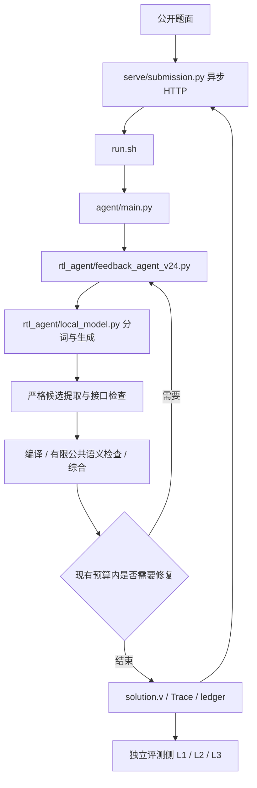

# 当前运行架构

本开发副本来自 2026-10-27 已验证部署源码，不能用 D:/Rtl_Agent 根目录中的历史接口替代本包入口。

`serve/start.sh` 管理常驻模型；`serve/http.sh` 启动 HTTP，二者分开。`run_baseline.sh` 只调用官方 baseline.py，不读 Skill，不调用 EDA 或 Repair。推理客户端使用本地 OpenAI 兼容接口；不能绕过 tokenizer 容量与累计 Token 门。

Agent 先读取公开规格和冻结 Skill，逐轮生成候选，经唯一 TopModule、去重、接口和工具检查后决定修复或停止。诊断与反馈集中在 feedback_agent_v24.py、targeted_diagnostics_v24.py、public_semantic_probes_v24.py 和 public_repair_directions_v24.py；EDA 证据由 eda_evidence.py 等模块持久化。

有限公共性质检查只支持限定结构，保留 RESOLVED、UNRESOLVED、INDETERMINATE 的语义。它们不是完整的 SystemVerilog 功能验证器。内部综合成功不等于独立 L2 通过。评测 TB、参考实现和隐藏向量必须留在独立评测侧。

修改前端不要求修改这些运行模块。修改运行模块时，应在单独分支固定来源和测试结果，不能静默覆盖比赛版本。
